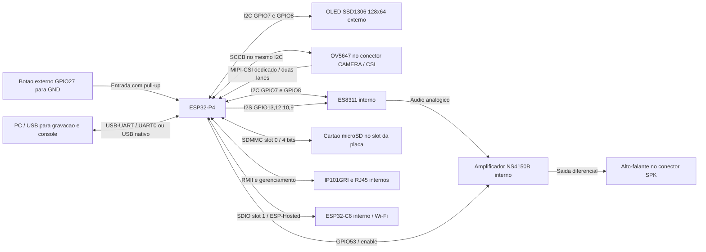

# Mapa de pinos e esquema de ligações — ESP32-P4

Revisão: **22/10/2026**. Referência do código: **v1.20.0**, placa **Waveshare ESP32-P4-Module-DEV-KIT**, pacote Arduino ESP32 **3.3.12**, variante `esp32p4`.

Este documento combina a configuração do firmware, os padrões do SDK e o esquema elétrico da placa. As ligações internas já existem na placa; não precisam de jumpers externos. OLED e botão são as ligações externas descritas pelo projeto; câmera e alto-falante usam seus conectores próprios.

**GPIO não é número físico do conector.** Exemplo: GPIO27 é o pino físico **38** do conector P6. O pino físico 27 é GPIO24.

## 1. Visão geral



O LED controlado pelo firmware está atribuído ao **GPIO1**. A presença de um LED físico ligado a esse GPIO não foi confirmada pelo esquema: o LED de alimentação da base não é um LED controlável pelo GPIO1.

## 2. GPIOs selecionados diretamente pelo projeto

Direções são relativas ao ESP32-P4.

| GPIO | Sinal | Direção | Ligação / uso | Origem |
| ---: | --- | --- | --- | --- |
| 1 | LED lógico | Saída | `led_on`, `led_off`, sinalização da conexão e interruptor MQTT; carga externa não confirmada | `LED_PIN` |
| 7 | SDA | Bidirecional | OLED, ES8311 e SCCB da câmera no mesmo barramento | `PIN_SDA` / Wire |
| 8 | SCL | Clock de saída | Clock do mesmo barramento I²C | `PIN_SCL` / Wire |
| 9 | I2S DOUT | Saída | ESP32-P4 → **DSDIN do ES8311** | `AUDIO_DOUT` |
| 10 | I2S LRCK / WS | Saída | Seleção de canal do codec | `AUDIO_LRCK` |
| 12 | I2S BCLK / SCLK | Saída | Clock de bits do codec | `AUDIO_BCLK` |
| 13 | I2S MCLK | Saída | Clock mestre do codec | `AUDIO_MCLK` |
| 27 | Botão de navegação | Entrada | Botão entre GPIO27 e GND; `INPUT_PULLUP`, pressionado = LOW | `BOTAO_RESET` — nome antigo, função atual é navegação |
| 31 | Ethernet MDC | Saída | Gerenciamento do PHY IP101GRI | `ETH_PHY_MDC` |
| 51 | Ethernet reset / habilitação | Saída | Controle do PHY, tratado pelo driver Ethernet | `ETH_PHY_POWER` — nome da configuração |
| 52 | Ethernet MDIO | Bidirecional | Gerenciamento do PHY IP101GRI | `ETH_PHY_MDIO` |
| 53 | Enable do amplificador | Saída | Habilita o NS4150B; HIGH durante a reprodução | `AUDIO_AMP_ENABLE` |

O áudio usa **48 kHz, 16 bits, dois slots com o mesmo sinal**. GPIO9 é saída do P4; não confundir com a saída de captura do codec em GPIO11.

### Endereços I²C / SCCB

| Endereço de 7 bits | Dispositivo | Estado no projeto |
| --- | --- | --- |
| `0x3C` | OLED SSD1306 | Explicitamente usado pelo firmware |
| `0x18` | Codec ES8311 | Explicitamente usado pelo firmware |
| `0x36` | Sensor OV5647 | Endereço padrão do sensor; detecção/configuração feita pelo driver |

OLED, codec e câmera compartilham **GPIO7/GPIO8**. A câmera reutiliza o handle da Wire, em vez de criar outro controlador nas mesmas linhas. O SCCB da câmera é configurado para 100 kHz. O esquema da base mostra pull-ups de **2,2 kΩ** em SDA/SCL; módulos externos podem acrescentar outros pull-ups em paralelo.

## 3. Ethernet: todos os sinais usados

O PHY e o circuito do RJ45 são internos. O firmware usa IP101, endereço de gerenciamento **1**, com clock RMII externo (`EMAC_CLK_EXT_IN`).

| GPIO | Sinal | Direção no P4 | Definição |
| ---: | --- | --- | --- |
| 28 | CRS_DV | Entrada | Variante Arduino / RMII |
| 29 | RXD0 | Entrada | Variante Arduino / RMII |
| 30 | RXD1 | Entrada | Variante Arduino / RMII |
| 31 | MDC | Saída | Projeto |
| 34 | TXD0 | Saída | Variante Arduino / RMII |
| 35 | TXD1 | Saída | Variante Arduino / RMII; também ligado ao botão BOOT |
| 49 | TX_EN | Saída | Variante Arduino / RMII |
| 50 | REF_CLK, 50 MHz | Entrada | Referência RMII fornecida pelo circuito do PHY |
| 51 | Controle de reset / habilitação do PHY | Saída | Projeto / driver |
| 52 | MDIO | Bidirecional | Projeto |

**GPIO35 não está livre:** a placa compartilha esse sinal com BOOT e Ethernet TXD1. O botão de navegação externo permanece no GPIO27. RESET/RST atua em `ESP_EN`, não é o botão GPIO27.

## 4. Cartão microSD: pinos implícitos no SDK

`SD_MMC.begin("/sdcard", false)` seleciona modo **4 bits**. Na variante `esp32p4`, o cartão usa **slot 0**, distinto do slot SDIO do rádio.

| GPIO | Sinal | Direção no P4 | Ligação |
| ---: | --- | --- | --- |
| 39 | SD D0 | Bidirecional | Slot microSD interno |
| 40 | SD D1 | Bidirecional | Slot microSD interno |
| 41 | SD D2 | Bidirecional | Slot microSD interno |
| 42 | SD D3 | Bidirecional | Slot microSD interno |
| 43 | SD CLK | Saída | Slot microSD interno |
| 44 | SD CMD | Bidirecional | Slot microSD interno |
| 45 | Controle de alimentação do SD | Saída | Habilitação ativa em LOW na variante instalada |

O SDK também seleciona o **LDO interno, canal 4 / VO4**, para a alimentação de I/O correspondente. Isso não é um GPIO adicional. A base possui alternativas de alimentação por componentes montados/não montados, conforme o esquema.

GPIO45 **não é D4 neste projeto**: o modo é de quatro bits e esse pino controla a alimentação. GPIO46/47/48 também não são usados como D5/D6/D7 neste modo.

## 5. Rádio ESP32-C6: pinos do ESP-Hosted

O P4 não tem rádio próprio. O pacote instalado configura a comunicação com o coprocessador por **SDIO slot 1, quatro bits, clock de 40 MHz**.

| GPIO do P4 | Sinal | Direção no P4 | Origem |
| ---: | --- | --- | --- |
| 14 | SDIO D0 | Bidirecional | `CONFIG_ESP_HOSTED_SDIO_PIN_D0` |
| 15 | SDIO D1 | Bidirecional | `CONFIG_ESP_HOSTED_SDIO_PIN_D1` |
| 16 | SDIO D2 | Bidirecional | `CONFIG_ESP_HOSTED_SDIO_PIN_D2` |
| 17 | SDIO D3 | Bidirecional | `CONFIG_ESP_HOSTED_SDIO_PIN_D3` |
| 18 | SDIO CLK | Saída | `CONFIG_ESP_HOSTED_SDIO_PIN_CLK` |
| 19 | SDIO CMD | Bidirecional | `CONFIG_ESP_HOSTED_SDIO_PIN_CMD` |
| 54 | Reset / controle do coprocessador | Saída | `CONFIG_ESP_HOSTED_SDIO_GPIO_RESET_SLAVE` |

Esses são os valores do `sdkconfig.h` do pacote Arduino usado como referência, não definições explícitas de `DeviceConfig.h`. A conexão entre os chips fica no módulo; a polaridade e a sequência de reset são responsabilidade do ESP-Hosted. Não reutilizar GPIO54, mesmo estando acessível no conector de 40 pinos.

Os nomes `C6_U0TXD`, `C6_U0RXD` e `C6_IO9` no conector de manutenção do C6 pertencem ao **C6**, não são GPIOs com esses números no P4.

## 6. Câmera OV5647

```text
ESP32-P4 / placa                           OV5647
─────────────────────────────────────────────────────────
GPIO7  / SDA ── barramento I2C/SCCB ────── SDA do sensor
GPIO8  / SCL ── barramento I2C/SCCB ────── SCL do sensor
CSI_D0_P / CSI_D0_N <───────────────────── Lane de dados 0
CSI_D1_P / CSI_D1_N <───────────────────── Lane de dados 1
CSI_CLK_P / CSI_CLK_N <─────────────────── Clock MIPI
Alimentação e GND ── pelo conector CSI ─── Alimentação e GND
```

As linhas `CSI_*` são **pads dedicados MIPI**, não números de GPIO escolhidos no firmware. O driver também cuida da alimentação/recursos MIPI necessários. Não equivalem a seis GPIOs livres.

A câmera deve ficar no conector **CAMERA / CSI**, por cabo flat. O conector **DISPLAY / DSI** é diferente. Neste projeto não há pino GPIO de XCLK, RESET ou PWDN atribuído à câmera: a configuração utiliza os valores padrão `-1` para reset/power-down. Isso não substitui a ligação de alimentação prevista no módulo da câmera.

## 7. Esquema das ligações externas

### OLED SSD1306 e botão

```text
                     ESP32-P4 / P6                 OLED SSD1306
                     ─────────────                 ────────────
                     3V3 [1 ou 17] ─────────────── VCC (*)
                     GND [6, 9, ...] ───────────── GND
                     GPIO7 [3] ────────────────── SDA
                     GPIO8 [5] ────────────────── SCL
                          │      │
                          │      └── ES8311 SCL + OV5647 SCL (internos)
                          └───────── ES8311 SDA + OV5647 SDA (internos)

       3V3 interno
           │
     pull-up interno
           │
GPIO27 [38]┴────────── o  o ───────────── GND [39, por exemplo]
                      BOTÃO
                    normalmente aberto

Solto: HIGH                         Pressionado: LOW
```

`[n]` indica o pino físico do conector P6. O botão não recebe 5 V nem precisa de resistor externo para funcionar com `INPUT_PULLUP`.

(*) A alimentação do OLED não é definida pelo código e não foi medida na montagem. O desenho especifica **3,3 V para um módulo compatível**, com lógica/pull-ups de 3,3 V. Confira a identificação VCC/GND/SCL/SDA do seu módulo: a ordem física varia. Não aplicar 5 V às linhas SDA/SCL/GPIO.

### Áudio e alto-falante

```text
ESP32-P4                 ES8311 (já na placa)
GPIO7  ────────────────> SDA, controle I2C 0x18
GPIO8  ────────────────> SCL
GPIO13 ────────────────> MCLK
GPIO12 ────────────────> SCLK / BCLK
GPIO10 ────────────────> LRCK / WS
GPIO9  ────────────────> DSDIN, áudio recebido pelo codec

                         Saídas analógicas do codec
                                   │
                                   ▼
GPIO53 ── enable ──────> NS4150B (amplificador já na placa)
                                   │
                         OUT+ ──────┤
                                  [ ALTO-FALANTE ]  conector SPK
                         OUT− ──────┤
```

O conector SPK da placa é de dois terminais, para alto-falante **8 Ω / 2 W** conforme a documentação do kit. A saída é diferencial: **nenhum terminal do alto-falante deve ser ligado ao GND**. Codec, amplificador, filtros, alimentação e ligação entre eles já estão na placa.

O microfone também existe na placa. A saída digital de captura do ES8311 chega ao **GPIO11**, mas o firmware atual configura `din = I2S_GPIO_UNUSED`; portanto **não captura o microfone**.

### Rede, armazenamento e alimentação

```text
USB-C / entrada de alimentação → circuito de alimentação da placa
                               ├─ ESP32-P4 + flash/PSRAM do módulo
                               ├─ ESP32-C6 e circuitos internos
                               ├─ PHY Ethernet → RJ45 → cabo de rede
                               ├─ microSD → cartão inserido no slot
                               ├─ ES8311 + amplificador → SPK
                               └─ barramentos/conectores de periféricos

SPIFFS / NVS / aplicações OTA: flash interna do módulo, sem fios externos.
Home Assistant / MQTT / Prometheus: tráfego de rede, sem GPIO exclusivo.
```

## 8. Conector P6: correspondência dos 40 pinos

Vista de referência: mesma orientação da figura de pinout do fabricante, **3V3 no canto superior esquerdo e 5V no superior direito**, olhando o lado dos componentes. Identifique o pino 1 na placa antes de montar; girar a placa muda a posição visual.

| Pino ímpar | Sinal | Pino par | Sinal |
| ---: | --- | ---: | --- |
| 1 | 3V3 | 2 | 5V |
| 3 | GPIO7 — SDA compartilhado | 4 | 5V |
| 5 | GPIO8 — SCL compartilhado | 6 | GND |
| 7 | GPIO23 | 8 | GPIO37 — UART0 TX |
| 9 | GND | 10 | GPIO38 — UART0 RX |
| 11 | GPIO21 | 12 | GPIO22 |
| 13 | GPIO20 | 14 | GND |
| 15 | GPIO6 | 16 | GPIO5 |
| 17 | 3V3 | 18 | GPIO4 |
| 19 | GPIO3 | 20 | GND |
| 21 | GPIO2 | 22 | GPIO1 — saída LED lógica |
| 23 | GPIO0 | 24 | GPIO36 |
| 25 | GND | 26 | GPIO32 — também no conector I3C |
| 27 | GPIO24 — USB nativo D− | 28 | GPIO25 — USB nativo D+ |
| 29 | GPIO33 — também no conector I3C | 30 | GND |
| 31 | GPIO26 | 32 | GPIO54 — rádio / reset |
| 33 | GPIO48 | 34 | GND |
| 35 | GPIO53 — enable amplificador | 36 | GPIO46 |
| 37 | GPIO47 | 38 | GPIO27 — botão externo |
| 39 | GND | 40 | GPIO45 — alimentação SD |

Estar no P6 **não significa estar disponível**. GPIO7/8, 1, 27, 45, 53 e 54 já têm usos nesta configuração. GPIO24/25 têm ligação USB na base; GPIO37/38 têm ligação UART e GPIO32/33 saem também no conector I3C.

### Outras reservas da placa

| Sinal / GPIO | Ligação física / observação | Uso atual |
| --- | --- | --- |
| GPIO11 | Saída ADC digital do codec / microfone | Não habilitado pelo firmware; conexão interna existe |
| GPIO24 / GPIO25 | USB nativo, D− / D+ | Reservar para a função USB; console USB depende das opções de compilação |
| GPIO37 / GPIO38 | UART0 TX / RX, ligados ao conversor USB-UART | Programação/console UART; `Serial` pode usar USB CDC se essa opção estiver habilitada no IDE |
| GPIO35 | BOOT e RMII TXD1 | Compartilhamento interno; não usar como botão de navegação |
| GPIO36 | Pino de strapping/modo de boot do P4 | Não atribuído pelo projeto, mas exige cuidado com níveis durante reset |
| GPIO32 / GPIO33 | Conector I3C | I3C não é iniciado por este firmware |
| GPIO26 / GPIO27 | Função alternativa de PHY USB OTG full-speed | GPIO27 está no botão; não habilitar essa função alternativa sobre o botão |
| USB OTG high-speed | Pads dedicados / mux / hub CH334 da placa | USB-A agora usa host HS dedicado / TinyUSB; não confundir com o PHY FS alternativo de GPIO26/27 |
| DSI | Pads dedicados do conector DISPLAY | Nenhum LCD DSI inicializado |
| Flash e PSRAM | Ligações internas do módulo/encapsulamento | Não são os pinos SDMMC nem ligações externas para remontar |

GPIOs sem atribuição funcional explícita pelo aplicativo no P6 incluem **0, 2, 3, 4, 5, 6, 20, 21, 22, 23, 26, 32, 33, 36, 46, 47 e 48**. Essa lista não garante ausência de função alternativa, strapping ou ligação no circuito; veja a tabela de reservas antes de acrescentar periféricos.

## 9. Conferência rápida de conflitos

- **I²C compartilhado:** GPIO7/8 pertencem a OLED, codec e câmera. Não remapear/inicializar outra Wire nessas linhas sem coordenar os três drivers.
- **Botão:** GPIO27, pino físico 38; não é BOOT nem RST.
- **Áudio:** GPIO9/10/12/13 e GPIO53 já estão ocupados; GPIO11 está ligado fisicamente ao codec, mesmo sem captura habilitada.
- **Ethernet:** reservar GPIO28/29/30/31/34/35/49/50/51/52.
- **Cartão:** reservar GPIO39/40/41/42/43/44/45.
- **Rádio:** reservar GPIO14/15/16/17/18/19/54 conforme o SDK atual.
- **LED:** o firmware controla GPIO1, mas o LED de alimentação não comprova uma ligação GPIO1 → LED físico. Se for acrescentar um LED externo, usar resistor em série dimensionado para ele; isso é uma nova ligação, não uma ligação confirmada deste mapa.
- **Tensões:** os números 5V/3V3/GND representam alimentação, não GPIOs. Não ligar 5 V a entradas de sinal do P4.

## 10. Fontes e limites da conferência

1. [DeviceConfig.h](DeviceConfig.h): GPIOs configurados pelo projeto.
2. [PageAudio.cpp](PageAudio.cpp), [CameraService.cpp](CameraService.cpp), [OledDisplay.cpp](OledDisplay.cpp), [StorageManager.cpp](StorageManager.cpp), [NetworkController.cpp](NetworkController.cpp) e [sketch principal](wifi_Eth_SDCard.ino): uso real dos periféricos.
3. `variants/esp32p4/pins_arduino.h` e `libraries/SD_MMC/src/SD_MMC.cpp`, Arduino ESP32 3.3.12: Ethernet, SD slot 0, GPIO45 e canal de alimentação.
4. `soc/esp32p4/include/soc/sdmmc_pins.h`, SDK instalado: sinais SDMMC do slot 0.
5. `esp32p4-libs/3.3.12/qio_qspi/include/sdkconfig.h`: ESP-Hosted, SDIO slot 1 e reset do C6.
6. [Esquema elétrico local, página 1](<C:/PC/ESP32/ESP32_Documents/ESP32-P4-Module-DEV-KIT.pdf>): blocos CSI, codec, amplificador, PHY, microSD e interface.
7. [Pinout local do fabricante, página 5](<C:/PC/ESP32/ESP32_Documents/ESP32-P4-Module-DEV-KIT _ WaveShare Documentation_Pinout_Definition.pdf>): posição dos 40 pinos e conectores.

Este é um **esquema funcional de ligação em Markdown**, não uma reprodução completa da placa para fabricação: resistores de terminação, capacitores, proteção ESD, reguladores e trilhas diferenciais permanecem no esquema original. A alimentação real do OLED, uma eventual carga no GPIO1 e a continuidade dos fios externos não foram verificadas fisicamente. Se mudar a variante Arduino, a revisão da placa ou o SDK, conferir novamente os pinos implícitos.

## 11. Atualização USB Host — 1.20.0

USB-A habilitado via PHY UTMI high-speed dedicado e TinyUSB root port 1, sem acrescentar GPIO ao mapa e sem ocupar GPIO26/27. Jumper DEVICE seleciona as três portas via CH334; HOST seleciona a porta direta. Teclado/mouse HID e um pendrive MSC FAT são tratados pela tarefa USB; logs ficam no SD. USB-C de programação é separado. Consulte usb_status e a página /usb. Não foram acrescentados fios externos ou controle GPIO de VBUS; a alimentação e o mux seguem o circuito e o jumper da base.
