# ESP32-P4 Wi‑Fi + Ethernet + SDCard + OLED + USB Host + Camera + MQTT + Edge

<p align="center">
  
  
  
  
  
  
</p>

A production-style firmware project for **ESP32-P4-Module-DEV-KIT** that combines:

- Wi‑Fi STA/AP + Ethernet monitoring
- SSD1306 OLED dashboard with page rotation and button navigation
- Web portal + terminal + JSON APIs
- UDP command interface
- OTA update (web + Arduino OTA)
- SD logging with queue and rotation
- Prometheus exporter (custom metrics)
- MQTT + Home Assistant auto-discovery
- Local edge-rule processing
- MIPI-CSI camera services (snapshot + MJPEG streaming)
- USB Host (HID keyboard/mouse + MSC pendrive root listing)
- Crash diagnostics and persistence helpers

> Documentation baseline reviewed for firmware **v1.20.0** (updated on **2026-10-22** in repository docs).

---

## Table of contents

- [1) System overview](#1-system-overview)
- [2) Architecture](#2-architecture)
- [3) Hardware map (high level)](#3-hardware-map-high-level)
- [4) Build and flash](#4-build-and-flash)
- [5) Runtime interfaces](#5-runtime-interfaces)
- [6) OLED UX and physical button](#6-oled-ux-and-physical-button)
- [7) Camera and video services](#7-camera-and-video-services)
- [8) USB Host services](#8-usb-host-services)
- [9) MQTT + Home Assistant](#9-mqtt--home-assistant)
- [10) Edge computing rules](#10-edge-computing-rules)
- [11) Logging, crash diagnostics, and storage](#11-logging-crash-diagnostics-and-storage)
- [12) Prometheus metrics](#12-prometheus-metrics)
- [13) OTA workflow and safety](#13-ota-workflow-and-safety)
- [14) Repository structure](#14-repository-structure)
- [15) Validation status](#15-validation-status)
- [16) Related documentation](#16-related-documentation)

---

## 1) System overview

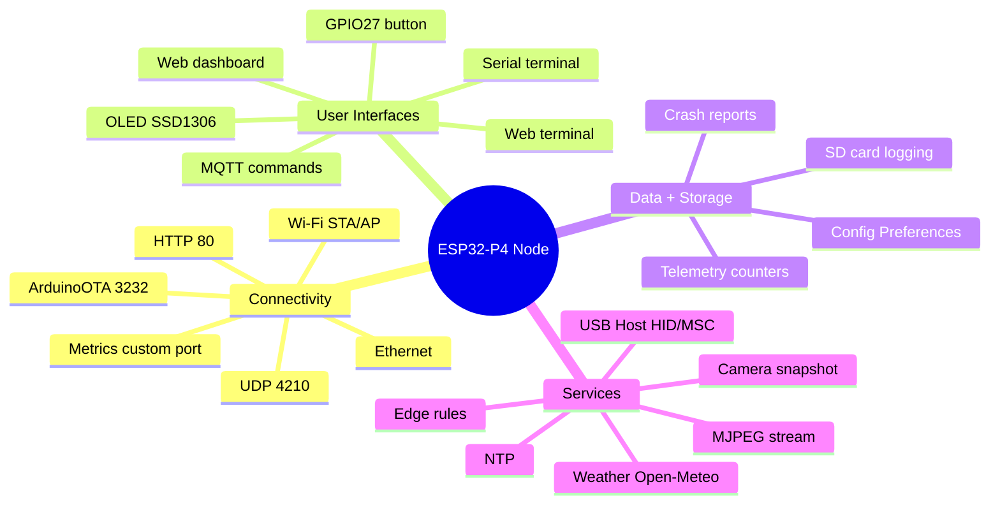

This firmware is designed as a **single device observability + control node**, exposing operational state through local UI, APIs, MQTT, and Prometheus.

---

## 2) Architecture

```mermaid
flowchart LR
  subgraph Inputs
    SERIAL[Serial Commands]
    UDP[UDP Commands :4210]
    WEB[Web UI / API :80]
    MQTTCMD[MQTT command topic]
    BTN[GPIO27 Button]
  end

  subgraph Core_App[App Core (main orchestration)]
    CMD[SlaveCommandHandler]
    NET[NetworkController/Monitor]
    OLED[OledDisplay]
    SD[StorageManager + SystemLog]
    EDGE[EdgeComputing]
    MET[PrometheusMetrics]
    OTA[FirmwareUpdater]
    CAM[CameraService]
    USB[UsbHostService]
    WEA[WeatherService]
    TIME[TimeManager]
    MQTT[MqttService]
  end

  subgraph Outputs
    OLED_OUT[SSD1306 Pages]
    HTTP_OUT[Portal + JSON APIs]
    METRICS[/metrics endpoint/]
    SD_OUT[/log.txt + rotation/]
    MQTT_OUT[HA discovery + state]
  end

  SERIAL --> CMD
  UDP --> CMD
  WEB --> CMD
  MQTTCMD --> CMD
  BTN --> OLED

  CMD --> NET
  CMD --> OLED
  CMD --> SD
  CMD --> OTA
  CMD --> CAM
  CMD --> USB
  CMD --> EDGE
  CMD --> MQTT

  NET --> MET
  CAM --> MET
  USB --> MET
  SD --> MET
  EDGE --> MET

  OLED --> OLED_OUT
  WEB --> HTTP_OUT
  MET --> METRICS
  SD --> SD_OUT
  MQTT --> MQTT_OUT
```

### Task/Core intent (as documented)

- A serial receive task runs on one core and the application loop/services on the other core.
- Command execution is queue-driven to avoid blocking ingress channels.
- OTA and long operations pause selected activities for consistency.

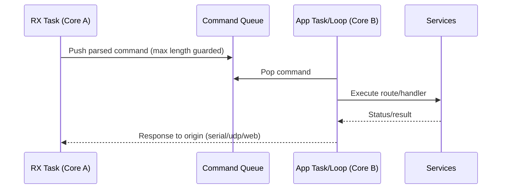

---

## 3) Hardware map (high level)

> For full pin-level details and electrical notes, see `MAPA_PINOS_E_ESQUEMA.md`.

```mermaid
flowchart TB
  P4[ESP32-P4 Module Dev Kit]
  OLED[SSD1306 OLED\nI2C]
  CODEC[ES8311 Codec + NS4150B Amp]
  BTN[Button GPIO27->GND]
  SD[SD Card / SDMMC]
  ETH[Ethernet Interface]
  WIFI[Wi-Fi Companion / STA/AP]
  CAM[OV5647 MIPI-CSI]
  USBA[USB-A Host Ports\n(HID/MSC)]

  P4 --> OLED
  P4 --> CODEC
  P4 --> BTN
  P4 --> SD
  P4 --> ETH
  P4 --> WIFI
  P4 --> CAM
  P4 --> USBA
```

---

## 4) Build and flash

### Toolchain assumptions

- **Arduino ESP32 core 3.3.12**
- Target board family: **esp32p4**
- PSRAM enabled for camera workloads

### Partitioning

This repository ships `partitions.csv` for larger OTA-capable layouts on 16MB flash targets.

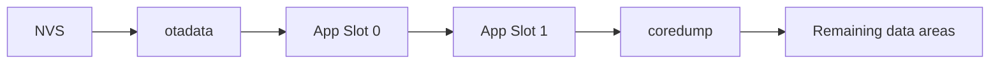

### First install

1. Use **USB/serial** for initial flash when changing partition table.
2. Keep `partitions.csv` in sketch root.
3. Use OTA only after base image and partition map are confirmed on device.

---

## 5) Runtime interfaces

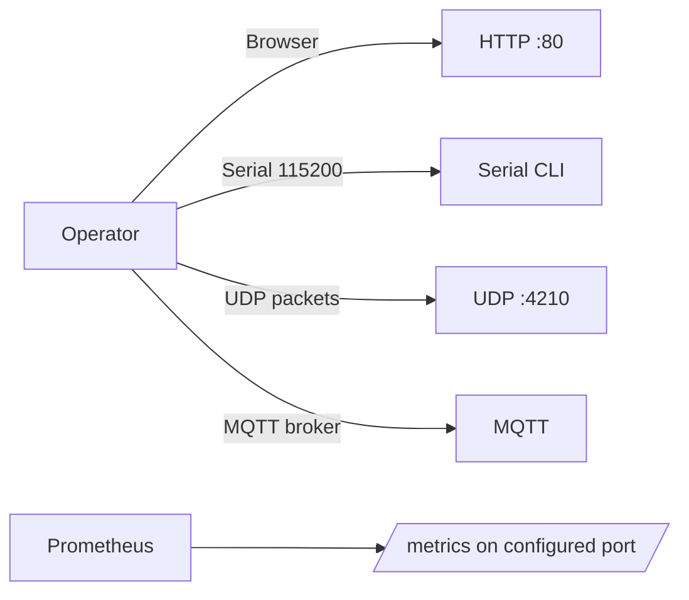

### HTTP pages and APIs (high level)

- Portal pages include root/info/config and feature pages such as logs, mqtt, edge, camera, usb, firmware, prometheus.
- JSON APIs expose dashboard, command execution, status surfaces for services, and configuration endpoints.

### Command channels

- Serial, UDP, and web terminal share command semantics.
- Command size is constrained and validated.

For full command syntax: **`COMANDOS.md`**.

---

## 6) OLED UX and physical button

- SSD1306 128x64 pages rotate automatically.
- Page commands (`tela:*`) allow forced selection and auto-rotation resume.
- **GPIO27 button** wakes/advances page with debounce.
- Robot screensaver mode and page-change audio notifications are supported in current documented firmware series.

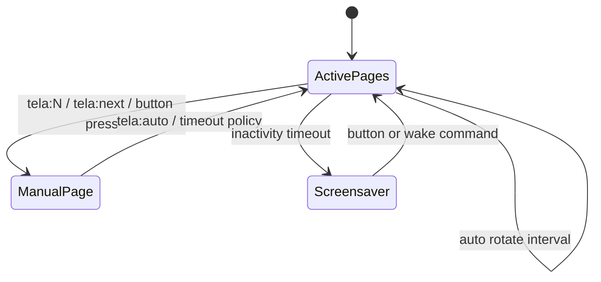

---

## 7) Camera and video services

The repository documents two camera-facing modes:

1. **Snapshot endpoint** (`/camera.jpg` or camera service pathing)
2. **MJPEG streaming** via dedicated stream server/port logic

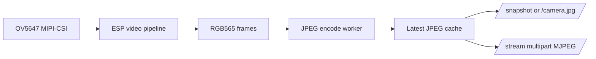

Operational constraints (as documented):

- Capture/encode rate limiting
- Concurrent stream/snapshot client limits
- OTA interaction pauses/rejections during update windows
- Status fields exposed through commands/API/metrics

---

## 8) USB Host services

USB Host support focuses on:

- HID keyboard/mouse connection/activity counters
- MSC pendrive mount (FAT family as documented)
- Root listing cache + rescan command path

```mermaid
flowchart TB
  USBHOST[USB Host controller] --> ENUM[Device enumeration]
  ENUM --> HIDK[HID Keyboard]
  ENUM --> HIDM[HID Mouse]
  ENUM --> MSC[Mass Storage]
  MSC --> MOUNT[/usb mount point]
  MOUNT --> ROOT[List root entries cache]
```

Status surfaces:

- `usb_status`
- `usb_list`
- `usb_rescan`
- `/api/usb/status`
- `/api/usb/files`

---

## 9) MQTT + Home Assistant

MQTT integration provides configuration, retained state publishing, availability, command intake, and Home Assistant discovery topics.

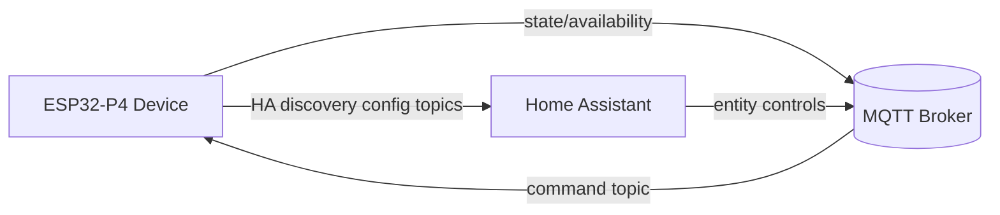

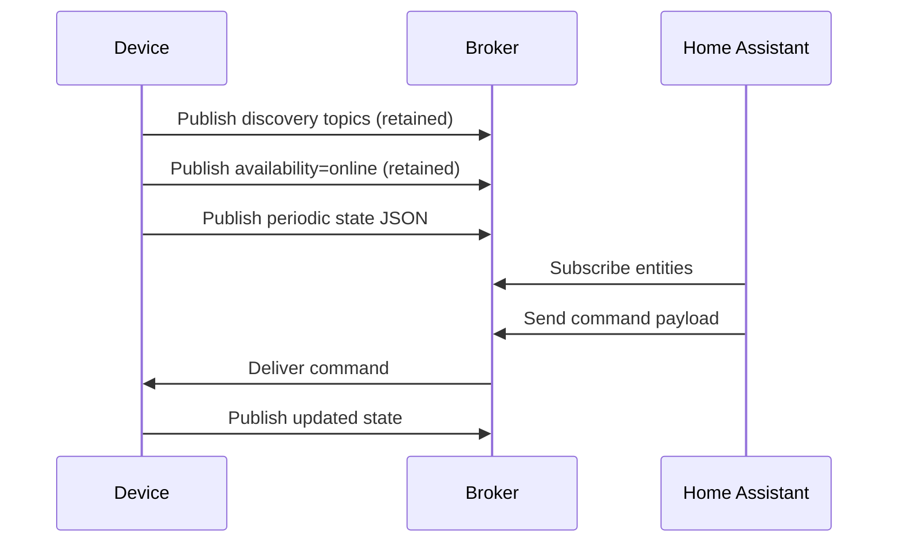

See `COMANDOS.md` and `PROMETHEUS.md` for supported command and metric mapping.

---

## 10) Edge computing rules

Rules evaluate local health and network conditions with thresholds and hysteresis/confirmation windows.

```mermaid
flowchart TD
  TICK[1s sampling tick] --> CPU{CPU >= limit?}
  TICK --> HEAP{Heap <= limit?}
  TICK --> NET{Wi-Fi+ETH both down?}
  TICK --> UDPERR{UDP send errors window >= limit?}

  CPU --> CONF1[Confirm window]
  HEAP --> CONF2[Confirm window]
  NET --> CONF3[Confirm window]
  UDPERR --> CONF4[Confirm window]

  CONF1 --> EVT[Emit edge event]
  CONF2 --> EVT
  CONF3 --> EVT
  CONF4 --> EVT

  EVT --> LOG[/log.txt]
  EVT --> MQTTE[MQTT edge event topic]
  EVT --> UI[Edge status API/UI]
```

---

## 11) Logging, crash diagnostics, and storage

### SD logging pipeline

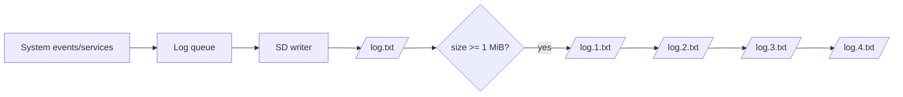

### Crash diagnostics

- `crash_info` flow archives crash details to SD, with verification checks before clearing internal crash record.
- Core dump interpretation depends on matching ELF for that firmware build.

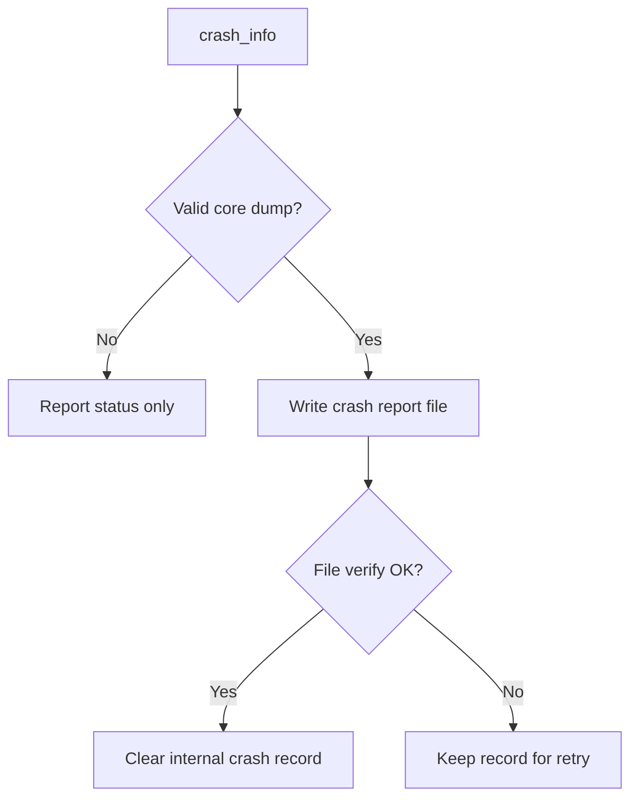

---

## 12) Prometheus metrics

The project exports a broad metric set including network, CPU, memory, SD, MQTT, camera, USB, edge, and UDP activity counters/gauges.

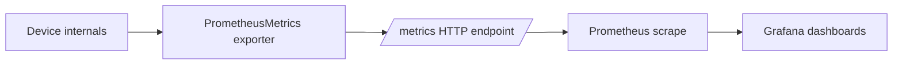

For metric names and semantics, use:

- `PROMETHEUS.md`
- `COMANDOS.md` (diagnostic command context)

---

## 13) OTA workflow and safety

Supported update paths:

- Web firmware page (authenticated route)
- Arduino OTA (network port)

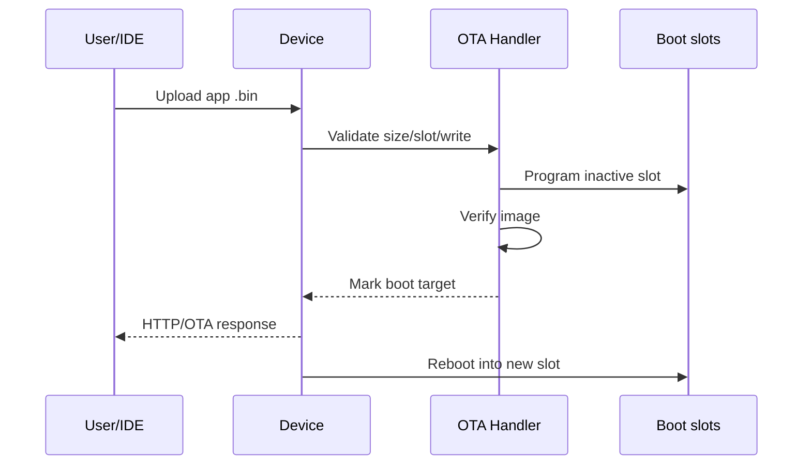

Safety notes in docs emphasize:

- correct image type (`.bin` application)
- stable power during update
- partition compatibility
- local/trusted network assumptions

---

## 14) Repository structure

```text
.
├─ wifi_Eth_SDCard.ino
├─ DeviceConfig.h
├─ FirmwareVersion.h
├─ NetworkController.*
├─ NetworkMonitor.*
├─ OledDisplay.*
├─ PageAudio.*
├─ TimeManager.*
├─ StorageManager.*
├─ SystemLog.*
├─ FirmwareUpdater.*
├─ MqttService.*
├─ EdgeComputing.*
├─ CameraService.*
├─ UsbHostService.*
├─ WeatherService.*
├─ CrashDiagnostics.*
├─ PrometheusMetrics.*
├─ PortalUi.h
├─ PrometheusUi.h
├─ SlaveCommandHandler.*
├─ partitions.csv
├─ README.md
├─ LEIA-ME.md
├─ COMANDOS.md
├─ PROMETHEUS.md
├─ MAPA_PINOS_E_ESQUEMA.md
└─ CHANGELOG.md
```

---

## 15) Validation status

Based on repository notes for the current documented line:

- Interface and partition test suites are repeatedly referenced as passing in the release notes.
- Hardware-in-the-loop validation (real board behavior) is intentionally called out as required by the operator for final confirmation.

Practical recommendation:

1. Rebuild with your exact board/flash/PSRAM options.
2. Validate serial + UDP + web terminal command paths.
3. Validate OLED/button/audio on physical hardware.
4. Validate camera snapshot/stream concurrency and OTA interactions.
5. Validate SD logging rotation and crash report archival.
6. Validate MQTT + Home Assistant discovery on your broker.
7. Validate Prometheus scrape path/port and dashboard queries.

---

## 16) Related documentation

- [COMANDOS.md](COMANDOS.md) — complete command reference
- [LEIA-ME.md](LEIA-ME.md) — Portuguese guide
- [PROMETHEUS.md](PROMETHEUS.md) — metric and integration details
- [MAPA_PINOS_E_ESQUEMA.md](MAPA_PINOS_E_ESQUEMA.md) — pinout and wiring map
- [CHANGELOG.md](CHANGELOG.md) — version timeline

---

## License / usage

No explicit license file was detected at repository root in this revision. Add a `LICENSE` file if you intend to publish redistribution terms.
