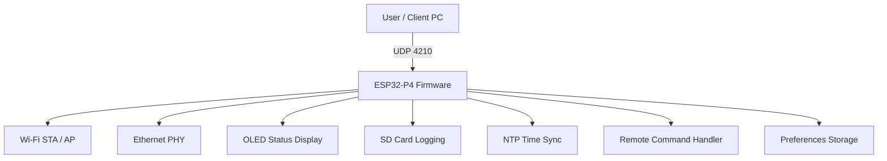

# ESP32 WiFi + Ethernet + SD Card + OLED Control Platform

[](https://www.espressif.com/)
[](https://www.arduino.cc/)
[](./LICENSE)

A polished embedded firmware platform for the **ESP32-P4 DevKit** that combines **Wi-Fi**, **Ethernet**, **SD card logging**, **OLED status display**, **NTP time synchronization**, and a **UDP remote command console** in a single modular codebase.

This repository is organized as an Arduino/ESP32 sketch plus helper modules for networking, display, storage, time handling, and command processing.

---

## Premium GitHub Edition

This README has been refined to work well as a **project showcase page on GitHub**:

- clear value proposition at the top
- visual badges for quick scanning
- architecture-first documentation
- feature summaries for contributors and visitors
- operational flow and command reference
- setup, troubleshooting, and roadmap sections

If you are using this project in a portfolio, client demo, or open-source showcase, this version is designed to feel more professional and easier to navigate.

---

## What This Project Does

The firmware can operate as a compact networked controller with:

- **Wi-Fi station mode** using stored credentials
- **Wi-Fi access point mode** with a local configuration portal
- **Ethernet support** with automatic fallback and route priority
- **SD card logging** for diagnostics and system events
- **OLED display** for live status and log history
- **UDP command interface** on port `4210`
- **NTP time synchronization** for accurate timestamps
- **Reset button support** to clear saved Wi-Fi settings

It is well suited for remote monitoring, device orchestration, network test setups, and embedded data-logging applications.

---

## Key Highlights

- Modular architecture with separate components for network, display, storage, time, and commands
- Dual-network support: Wi-Fi and Ethernet
- Captive portal for quick field configuration
- Persistent preferences storage for Wi-Fi and time settings
- Internal temperature sensor support
- Timestamped SD card logs
- OLED live clock and scrolling status lines
- UDP remote control and telemetry

---

## Hardware Overview

| Function | ESP32-P4 Pin | Purpose |
| --- | --- | --- |
| OLED SDA | GPIO7 | I2C data |
| OLED SCL | GPIO8 | I2C clock |
| Status LED | GPIO1 | Visual system indicator |
| Reset Button | GPIO2 | Clears saved Wi-Fi settings |
| Ethernet MDC | GPIO31 | PHY management |
| Ethernet MDIO | GPIO52 | PHY management |
| Ethernet Power/Reset | GPIO51 | PHY power control |
| SD Card | SD_MMC | Native storage and logging |

> The current firmware targets the **ESP32-P4 DevKit** and uses `ETH_PHY_IP101` by default.

---

## Architecture



### Runtime Flow

1. Boot at `115200` baud
2. Initialize LED, reset button, OLED, SD card, and networking
3. Try saved Wi-Fi credentials
4. If Wi-Fi connects, show IP and sync time
5. Bring up Ethernet and configure route priority
6. If Wi-Fi credentials are missing, start the configuration portal
7. Process UDP commands and update OLED/logs continuously

---

## Current Firmware Modules

| File | Role |
| --- | --- |
| `wifi_Eth_SDCard.ino` | Main setup and loop orchestration |
| `DeviceConfig.h` | Hardware pins and system constants |
| `NetworkController.h/.cpp` | Wi-Fi, Ethernet, portal, UDP, and route management |
| `OledDisplay.h/.cpp` | OLED rendering and message history |
| `StorageManager.h/.cpp` | SD card mounting and log writing |
| `TimeManager.h/.cpp` | NTP sync and time formatting |
| `SlaveCommandHandler.h/.cpp` | Command parsing and remote actions |

---

## Features

- Automatic Wi-Fi credential loading
- Access point portal at `http://192.168.4.1`
- Ethernet initialization and priority configuration
- SD card mount and log writing to `/log.txt`
- OLED screen with clock, history, and optional progress UI
- Internal temperature reading
- Remote command execution over UDP
- File listing and SD file access via commands
- Reset workflow to erase Wi-Fi credentials without reflashing

---

## Supported UDP Commands

The project listens on **UDP port 4210**.

| Command | Description |
| --- | --- |
| `RESET_WIFI` | Clear saved credentials and restart |
| `LED_ON` | Turn LED on |
| `LED_OFF` | Turn LED off |
| `TEMP` | Read internal temperature |
| `CPU` | Show CPU information |
| `RAM` | Show memory status |
| `FLASH` | Show flash usage information |
| `INIT` | Show reset reason |
| `UPTIME` | Show uptime |
| `MAC` | Show MAC address |
| `NET_INFO` | Show network status |
| `LIST` | List SD card files |
| `READ:path` | Read a file from SD card |
| `DEL:path` | Delete a file from SD card |
| `LED_PISCA:x:y` | Blink the LED x times with y ms interval |
| `LED_BLINK:n` | Continuous blink with n ms interval |

### Example

```bash
# Turn on the LED
echo "LED_ON" | nc -u 192.168.1.100 4210

# Read temperature
echo "TEMP" | nc -u 192.168.1.100 4210

# List SD contents
echo "LIST" | nc -u 192.168.1.100 4210
```

---

## Configuration Portal

When no Wi-Fi credentials are stored, the device starts an access point:

- **SSID:** `ESP32_P4_CONFIG`
- **Portal IP:** `192.168.4.1`

Users can enter one or more SSIDs and passwords, save them to flash memory, and reboot automatically into station mode.

---

## SD Card Logging

Logs are written to:

```text
/log.txt
```

Example format:

```text
[25/09/2026 08:15:30] OLED Pronto!
[25/09/2026 08:15:31] Wifi Conectado!
[25/09/2026 08:15:33] NTP Status SUCESSO! Sincronização concluída.
```

If time is not yet synchronized, the system falls back to a placeholder timestamp.

---

## Time Synchronization

The project synchronizes with multiple NTP sources:

- `a.st1.ntp.br`
- `pool.ntp.org`
- `time.nist.gov`

The default time zone is stored in preferences and currently defaults to **UTC-3**.

---

## Build Requirements

### Arduino Libraries

Most dependencies are built-in to the ESP32 platform, plus:

- Adafruit GFX Library
- Adafruit SSD1306

### Suggested Arduino IDE Settings

1. **Board:** ESP32 P4 Dev Module or compatible P4 board
2. **CPU Frequency:** 240 MHz
3. **Flash Size:** 4MB or higher
4. **Upload Speed:** 921600 or 460800
5. **Port:** Correct serial port for your board

### Build Steps

1. Open `wifi_Eth_SDCard.ino`
2. Select the correct board and port
3. Compile the sketch
4. Upload to the ESP32-P4
5. Open Serial Monitor at `115200`

---

## Troubleshooting

### OLED Not Working

- Check GPIO7 (SDA) and GPIO8 (SCL)
- Verify the display address is `0x3C`
- Confirm the serial output shows `OLED Pronto!`

### SD Card Not Mounting

- Use FAT32 or exFAT formatting
- Reinsert the card and check seating
- Review serial logs for mount errors

### Wi-Fi Connection Fails

- Use the `RESET_WIFI` command
- Confirm credentials in the portal
- Move closer to the access point

### Ethernet Issues

- Confirm PHY wiring on GPIO31, GPIO52, and GPIO51
- Verify the PHY type in `DeviceConfig.h`
- Check cable connection and network link status

### NTP Sync Problems

- Ensure network connectivity is active
- Wait longer on first boot
- Check whether DNS or internet access is blocked

---

## Project Status

- Core Wi-Fi setup and portal: implemented
- Ethernet support: implemented
- SD logging: implemented
- OLED UI: implemented
- UDP command console: implemented
- NTP synchronization: implemented
- Reset and recovery workflow: implemented

---

## Roadmap

Possible next additions:

- MQTT support
- HTTP/JSON API
- OTA firmware updates
- Web dashboard
- CSV/JSON export
- Additional sensors
- Watchdog support
- Power management modes

---

## License

Add your license file if you want to publish the project publicly.

---

## Contribution

Pull requests and issues are welcome.
