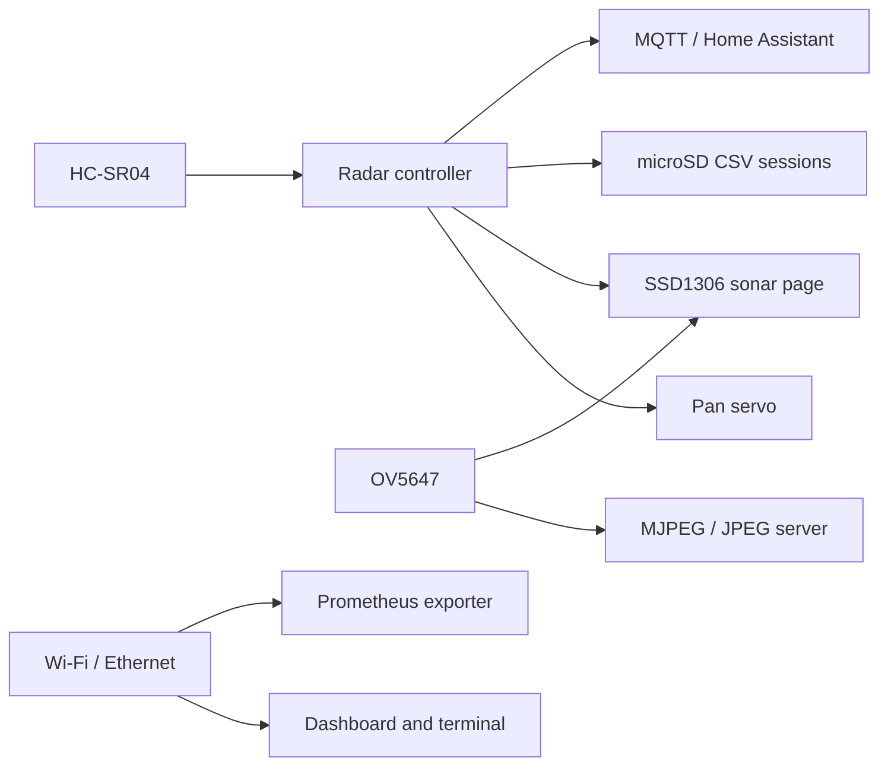

# ESP32-P4 Radar & Network Monitor

**A camera, ultrasonic radar, and network diagnostics console on a single ESP32-P4 dev kit.**


[Quick start](#quick-start) · [Hardware](MAPA_PINOS_E_ESQUEMA.md) · [Commands](COMANDOS.md) · [Release history](CHANGELOG.md)

| Feature | What you can do |
| --- | --- |
| **Radar and camera** | Sweep a 5°–175° servo arc with an HC-SR04, follow a confirmed echo, and view OV5647 MJPEG video. |
| **Local OLED** | Browse eight pages with a physical button. The camera and sonar pages stay visible until you navigate away. |
| **Network console** | Inspect Wi-Fi and Ethernet, gateway latency, connection events, and device health from the web, serial, or UDP. |
| **Telemetry and automation** | Scrape Prometheus metrics and discover controls and sensors in Home Assistant over MQTT. |
| **Diagnostics and maintenance** | Download radar CSV sessions, inspect rotating SD logs, use supported USB peripherals, and update firmware over the network. |

## Quick start

1. Use a **Waveshare ESP32-P4-Module-DEV-KIT** with 16 MiB flash. Follow the [wiring guide](MAPA_PINOS_E_ESQUEMA.md) and the [HC-SR04 guide](HC_SR04.md), especially the ECHO voltage divider.
2. Open [wifi_Eth_SDCard.ino](wifi_Eth_SDCard.ino) in Arduino IDE with the **Arduino ESP32 3.3.12** core. Keep the source files and [partitions.csv](partitions.csv) together in the sketch folder. Install **Adafruit SSD1306**, **Adafruit GFX**, and **ArduinoJson 7**.
3. Select the matching ESP32-P4 target, **16 MB Flash Size**, and **Custom Partition Scheme**. Use USB for the first installation or when migrating the partition layout.
4. Open the serial monitor at **115200 baud**, send `version` and `ip`, then open the device IP in a browser. If saved Wi-Fi profiles cannot connect, join `ESP32_P4_CONFIG` and visit `http://192.168.4.1/wifi`. Ethernet starts independently of Wi-Fi.

The [setup and operations guide](LEIA-ME.md) covers OTA, USB, and first-run checks. Use the project on a trusted network: the local portal and telemetry are HTTP, and the firmware ships with a fixed OTA credential.

## Try the radar

```text
ultrasonic:status
tela:7
servo:on
servo:rastrear:on
servo:status
```

`servo:on` starts the sweep. Tracking is disabled at boot and is enabled separately. The sonar page does not start the motor. The tracker uses ultrasonic echoes in one axis; it cannot identify a person, measure physical servo position, or control optical focus.

To capture a problem, send `radar_log:on`, reproduce it, and send `radar_log:off`. Open `http://DEVICE_IP/radar.csv` to download the latest session. The CSV distinguishes the commanded servo angle from the angle associated with the distance sample. See [radar tracking and diagnostics](RADAR_TRACKING.md).

## Interfaces

| Interface | Access |
| --- | --- |
| Web dashboard and terminal | `http://DEVICE_IP/info` |
| SD log viewer / USB status | `/logs` · `/usb` |
| Camera page | `/camera`; MJPEG at `http://DEVICE_IP:VIDEO_PORT/stream` |
| Firmware upload | `/firmware`; Arduino IDE network target `esp32-p4-node` |
| Prometheus | `/prometheus` · `/prometheus.yml` · `/metrics` on the configured exporter port |
| MQTT | Configure at `/mqtt`; use `mqtt_status` to verify connectivity and the topic prefix |
| Serial / UDP commands | 115200 baud / UDP port 4210; send `help` for the installed firmware's command list |

## How it fits together



## Documentation

| Guide | Contents |
| --- | --- |
| [Setup and operations](LEIA-ME.md) | Build configuration, network onboarding, USB, OTA, and smoke tests |
| [Command reference](COMANDOS.md) | Serial, UDP, web, and radar commands |
| [Hardware and pin map](MAPA_PINOS_E_ESQUEMA.md) | Wiring, P6 header, and shared board resources |
| [HC-SR04](HC_SR04.md) | Signal levels, filtering, and sensor diagnostics |
| [Radar tracking](RADAR_TRACKING.md) | Search, target selection, limitations, and CSV capture |
| [OLED sonar](SONAR_OLED.md) | Navigation, display symbols, and validation |
| [Prometheus](PROMETHEUS.md) | Scrape configuration, metric families, and example queries |
| [Changelog](CHANGELOG.md) | Firmware history through v1.25.3 |

## Verification

Run the automated web-interface and partition checks with Node.js:

```sh
node --test tests/*.test.cjs
```

These checks exercise simulated browser behavior and partition geometry. They do not compile firmware, flash the board, or validate electrical wiring, camera performance, or servo accuracy.
